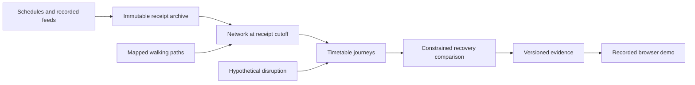

# Brisbane Transport Resilience Lab

I built this lab to explore a practical question: when a Brisbane bus or rail service is disrupted, where can a limited amount of extra bus service help? It replays archived service information, applies hypothetical disruptions, and lets a reviewer inspect the journeys, constraints and alternatives behind each recovery plan.

The pilot covers Fairfield/Annerley, South Bank and Brisbane CBD. I retain complete source trips and mapped pedestrian paths so the model can expose transfers and coverage gaps beyond the central map area.

**[Recorded demo](https://Suhail15.github.io/brisbane-transport-resilience-lab/) — release deployment is being verified.** The final private package contains three recorded mornings, 72 sampled frames and 54 completed comparisons. Public access, final release CI and packaged-artifact checks remain pending; the link is not yet a verified live-release claim.

Planned release assets: [short demo video](https://github.com/Suhail15/brisbane-transport-resilience-lab/releases/latest/download/demonstration.mp4) and [verification evidence / offline reproduction pack](https://github.com/Suhail15/brisbane-transport-resilience-lab/releases/latest). Asset uploads and public access are also being verified.

## What I found

On the fixed 100-query workload, none of the predefined cases lost or restored a journey within the 60-minute threshold. A stop closure still changed journey durations. One hypothetical two-hour bus duty reduced the aggregate capped query duration by **584, 782 and 782 seconds** on the three final mornings; larger budgets selected the same duty. Adding five or ten minutes to assumed bus running times removed that benefit, and the search selected no extra bus.

| Final morning | Queries within 60 minutes, baseline/disrupted/recovered | Available → selected bus-hours | Capped duration reduction versus no action |
|---|---|---|---|
| 19 October 2026 | 90 / 90 / 90 | 2 → 2 | 584 seconds |
| 20 October 2026 | 90 / 90 / 90 | 2 → 2 | 782 seconds |
| 21 October 2026 | 100 / 100 / 100 | 2 → 2 | 782 seconds |

These are simulated outcomes across fixed, equally weighted queries. They are not passenger counts, operational savings or proof of available buses. The bounded search does not prove global optimality. [Final findings](docs/FINDINGS.md) retain all scenarios, budgets, stresses and null outcomes; [development findings](docs/DEVELOPMENT_FINDINGS.md) preserve the earlier afternoon work separately.

## What you can inspect

- Replay real recorded frames with source receipt times and freshness labels: fifteen-minute samples, without interpolation.
- Apply trip cancellation, stop closure, rail-corridor closure or additional bus delay.
- Compare no intervention, a simple busiest affected service-pattern policy and the best evaluated recovery at 0/2/4/8 bus-hours.
- Inspect full journey legs, directed mapped walking paths, resource use, candidate feasibility and exact input identities.

Six weekday 06:00–12:00 collections were complete: 9, 13, 19, 20, 21 and 22 October. The first two are development, the next three are final evaluation, and October 22 is reserve. Final dates and targets were frozen before policy outcomes. Collection completeness does not imply fresh predictions or complete walking access.

## Verification and limits

An independent checker reconciled **54/54** final cases with their immutable inputs, source receipts, route arrays and duty constraints. Offline recomputation exactly reproduced **54/54** results in **508.35 seconds**. These checks establish reproducibility and the documented model accounting; they do not establish that predictions became observed arrivals.

Local checks passed **206 Python tests** (one optional infrastructure check skipped), **28 frontend tests**, and **2/2** separately enabled live API/PostGIS checks. Final release-candidate CI remains a separate pending check.

Independent OpenTripPlanner checks on the October 20 schedule retained raw agreement of **4/7 core cases** and **1/6 walking cases**. The walking equality was an absent-origin null result, not a transit match. Source-specific review checked 53 scheduled movements and 12 mapped walking paths with zero unexplained cases at that scope. Four original transit paths matched exactly; two additional direct-platform diagnostics were selected after the initial results. Differing access costs remain disclosed and uncalibrated. See the [reference validation](docs/REFERENCE_VALIDATION.md).

The journey API was measured with **300 HTTP queries** across the three mornings on an Apple M2 Mac with 16 GB RAM. The worst date's p95 was **0.17285 seconds**; two date batches overlapped, and first snapshot lookups were included. This is a journey-query benchmark, separate from recovery optimization and original queue times.

## Run locally

Requirements: Python 3.11, Node 22 and Docker Desktop. See [setup](docs/SETUP.md) for Windows commands and independent-router setup.

```sh
python3.11 -m venv .venv
.venv/bin/python -m pip install -r requirements.lock.txt
.venv/bin/python -m pip install -e . --no-deps
.venv/bin/python scripts/start.py infra
.venv/bin/python scripts/start.py prepare
.venv/bin/python scripts/start.py api
```

In a second terminal, run collection with the same environment:

```sh
.venv/bin/python scripts/start.py collect
```

The collector polls on weekdays from 06:00–12:00 Brisbane time. The computer must be awake and connected. Interrupted coverage is recorded and cannot count as a complete morning. `--force` is available for explicitly labelled development captures.

The API is at `http://127.0.0.1:8000/v1`, with interactive documentation at `/docs`.

Start the interface in another terminal:

```sh
cd frontend
npm ci
npm run dev
```

Open `http://localhost:5173/`. A prepared recorded bundle can also be built without the backend; see [setup](docs/SETUP.md) for the export and static-build commands.

## How the model works

The Connection Scan Algorithm routes timetable journeys using only records received by the selected cutoff. Missing or stale realtime matches retain labelled scheduled fallback. Walking uses actual directed OpenStreetMap paths; missing platform connectors remain unresolved.

Each relief candidate assigns one hypothetical bus for two hours, starts at least ten minutes after the decision, follows an existing paired bus pattern and includes five-minute terminal turns. The objective restores the most queries within sixty minutes, then minimizes capped duration and bus-hours. All 100 requests remain in the denominator, with unavailable duration scored at the ninety-minute cap. Search considers at most twelve candidates and 128 bounded swaps.



## Engineering and documentation

I used Python, pandas, DuckDB and Parquet for processing; PostgreSQL/PostGIS and Redpanda for operational storage and event delivery; FastAPI for the local API; and React, JavaScript, Vite and MapLibre for the interface. Docker Compose and GitHub Actions support setup and verification. Raw archives, databases and private reproduction packs stay outside Git history. Compact recorded bundles support backend-free exploration.

- [Final findings](docs/FINDINGS.md) and [evaluation method](docs/MORNING_EVALUATION.md)
- [Independent routing review](docs/REFERENCE_VALIDATION.md) and [release checklist](docs/IMPLEMENTATION_CHECKLIST.md)
- [Methodology](docs/METHODOLOGY.md), [contracts](docs/CONTRACTS.md) and [API](docs/API.md)
- [Source attribution and publication conditions](docs/SOURCES.md)
- [Data audit](docs/DATA_AUDIT.md), [collection](docs/COLLECTION.md), [setup](docs/SETUP.md) and [Mac/Windows handoffs](docs/WORKFLOW.md)
- [Final verification](docs/VERIFICATION.md), [historical development verification](docs/DEVELOPMENT_VERIFICATION.md), [decisions](docs/DECISIONS.md) and [project instructions](AGENTS.md)

Contains public transport data provided by Translink (Department of Transport and Main Roads, Queensland) under CC BY 4.0. Translink does not endorse and is not affiliated with this independent project or its simulation outcomes.

© [OpenStreetMap contributors](https://www.openstreetmap.org/copyright). Walking data is separately licensed under [ODbL 1.0](https://opendatacommons.org/licenses/odbl/1-0/). GTFS-derived data is selected, normalized and sampled; disruptions, extra buses and running-time stresses are hypothetical project changes. Source licences are separate from the project's code licence. See [source conditions](docs/SOURCES.md).
