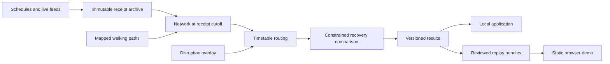

# Brisbane Transport Resilience Lab

Replay Brisbane bus and rail conditions, introduce a disruption, and compare recovery options with a limited number of extra bus-hours.

Transport disruption decisions have consequences beyond the affected route. Cancelling a service can break a connection elsewhere, and an extra bus only helps if its timing, stops and complete duty fit the journeys that need it. This project makes those trade-offs inspectable: every comparison uses the same test journeys, an archived network state and explicit operating assumptions.

## What it does

- Archives Translink schedules, trip updates, vehicle positions and alerts with receipt times and content hashes.
- Reconstructs a network using only information available at the selected time.
- Routes complete bus and rail trips with walking transfers using the Connection Scan Algorithm.
- Models trip cancellations, unavailable stops, corridor closures and additional delays as immutable overlays.
- Compares no intervention, a simple affected-pattern policy and a constrained recovery search at budgets of 0, 2, 4 and 8 bus-hours.
- Records source coverage, assumptions and calculation results alongside each experiment.

The pilot focuses on Fairfield/Annerley, South Bank and the CBD. Relevant routes retain their complete trips so alternatives outside the map's central area remain available. Walking links come from mapped pedestrian paths; missing entrances and connections remain visible coverage limits.

## Current status

**Private development release.** Real afternoon recordings are available for development. The morning evaluation and public demo are awaiting five complete weekday collection windows, three reviewed replay bundles and the remaining release checks. No simulated recovery is presented as an operational result or passenger saving.

The local suite currently passes 75 Python tests, including the live PostGIS checks, and eight frontend tests. The verification workflow checks Python on Linux, Windows and macOS, plus frontend installation, tests and build. See the [workflow history](https://github.com/Suhail15/brisbane-transport-resilience-lab/actions/workflows/ci.yaml) for the exact revision and results. The archive, PostgreSQL/PostGIS storage and Redpanda delivery have been exercised on the development Mac. Independent routing checks cover six exact real transit paths, with walking-access differences documented separately.

The current timetable includes Fairfield station platforms without active rail trips on the audited date. The lab reports that gap and uses active nearby bus stops for supported journeys. A timetable entry alone is not evidence of a running service.

## Run locally

Requirements: Python 3.11, Node 22 and Docker Desktop. See [setup](docs/SETUP.md) for Windows commands and independent-router setup.

```sh
python3.11 -m venv .venv
.venv/bin/python -m pip install -r requirements.lock.txt
.venv/bin/python -m pip install -e . --no-deps
.venv/bin/python scripts/start.py infra
.venv/bin/python scripts/start.py prepare
.venv/bin/python scripts/start.py api
```

In a second terminal, run collection with the same environment:

```sh
.venv/bin/python scripts/start.py collect
```

The collector polls on weekdays from 06:00–12:00 Brisbane time. The computer must be awake and connected. Interrupted coverage is recorded and cannot count as a complete morning. `--force` is available for explicitly labelled development captures.

The API is at `http://127.0.0.1:8000/v1`, with interactive documentation at `/docs`.

Start the interface in another terminal:

```sh
cd frontend
npm ci
npm run dev
```

Open `http://localhost:5173/`. A prepared recorded bundle can also be built without the backend; see [setup](docs/SETUP.md) for the export and static-build commands.

## How comparisons work

Primary results use equally weighted **test journeys**, not measured passenger counts. The main outcome is arrival within 60 minutes. Unreachable journeys remain in the denominator, and journey-duration scoring caps each request at 90 minutes.

Each candidate assigns one hypothetical bus to a two-hour duty, begins at least ten minutes after the decision time and uses an existing paired bus pattern with five-minute terminal turnarounds. The search returns the best feasible plan it evaluated. It does not claim global optimality except in the small cases checked exhaustively.

Historical origin–destination counts are monthly route-leg demand proxies. Provider trip updates are predictions unless the source establishes otherwise. Recovery services and disruptions are simulated. The [methodology](docs/METHODOLOGY.md) defines these boundaries, metrics and constraints.



## What the first development experiment found

A predefined two-hour stop closure was evaluated against a real Friday afternoon recording using 100 fixed test requests. All budgets retained the same requests and operating assumptions.

| Bus-hours available | Bus-hours selected | Arriving within 60 minutes | Capped duration reduction versus no action |
|---:|---:|---:|---:|
| 0 | 0 | 98 of 100 | 0 seconds |
| 2 | 2 | 98 of 100 | 320 seconds |
| 4 | 4 | 98 of 100 | 376 seconds |
| 8 | 4 | 98 of 100 | 376 seconds |

The result suggests modest duration improvements for this test set, with no additional benefit from doubling the four-hour budget. No journeys were restored within the 60-minute threshold because none had been lost under the nominal closure. Longer assumed bus running times made some proposed duties infeasible. These are simulated query outcomes, not passenger savings or morning evaluation findings.

The measured journey API p95 was **0.069 seconds** across 100 sequential HTTP queries on an Apple M2 Mac with 16 GB RAM. Recovery calculations run separately in the background. Full inputs, comparison limits and null findings are described in [findings](docs/FINDINGS.md).

## Engineering

Python, pandas, DuckDB and Parquet handle processing and analysis. PostgreSQL/PostGIS indexes operational and spatial records. Redpanda distributes archived-response references through its Kafka interface. FastAPI serves the local application; React, JavaScript, Vite and MapLibre provide its interface. Docker Compose and GitHub Actions support reproducible setup and verification.

Raw archives, local databases and development replay bundles stay outside Git history. The browser demo will use compact recorded bundles and work without the local backend.

## Documentation

- [Data audit and pilot coverage](docs/DATA_AUDIT.md)
- [Development findings](docs/FINDINGS.md), [verification record](docs/VERIFICATION.md) and [independent routing comparison](docs/REFERENCE_VALIDATION.md)
- [Methodology and analytical assumptions](docs/METHODOLOGY.md)
- [Contracts](docs/CONTRACTS.md) and [API](docs/API.md)
- [Source attribution and publication conditions](docs/SOURCES.md)
- [Collection](docs/COLLECTION.md), [setup](docs/SETUP.md) and [Mac/Windows handoffs](docs/WORKFLOW.md)
- [Implementation checklist](docs/IMPLEMENTATION_CHECKLIST.md)
- [Architecture decisions](docs/DECISIONS.md) and [agent instructions](AGENTS.md)

Source data is attributed to Queensland Department of Transport and Main Roads / Translink and OpenStreetMap contributors. Source licences and publication conditions are separate from the project's code licence. This is an independent project and is not endorsed by those publishers.
